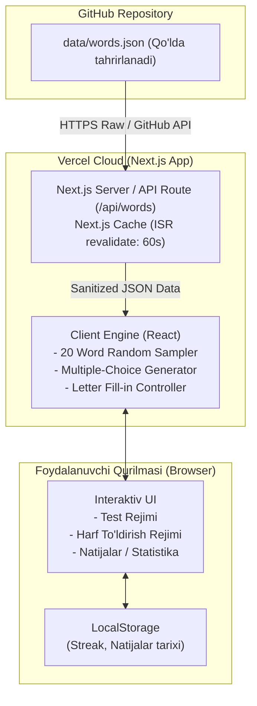

# 02. Texnik Arxitektura (Architecture)

## 1. Texnologik Stek (Technology Stack)

| Qatlam | Texnologiya | Sabab / Izoh |
| :--- | :--- | :--- |
| **Framework** | [Next.js](https://nextjs.org/) (App Router, Node.js muhiti) | Server-Side Rendering (SSR), API Routes, tezkor Edge rendering va Vercel bilan 100% integratsiya |
| **Til** | TypeScript | Qat'iy tiplashtirish, xatolarni oldini olish va ma'lumotlar sxemasi nazorati |
| **Dizayn & Stil** | [Tailwind CSS (CDN)](https://cdn.tailwindcss.com) | Node.js paketlariga ortiqcha yuklama qilmasdan, Next.js `<Script>` orqali tezkor va yengil yuklanish |
| **Ma'lumotlar Manbai** | GitHub Repository (`words.json`) | Qo'shimcha bazasiz (serverless/statik) arzon va oson saqlash |
| **Deploy & Hosting** | [Vercel](https://vercel.com/) | Git commit orqali avtomatik CI/CD, bepul global CDN, 99.9% uptime |

---

## 2. Arxitektura Sxemasi (Mermaid Diagram)



---

## 3. GitHub'dan Ma'lumotlarni Olish Mexanizmi (Data Fetching)

Ilova GitHub repodagi `words.json` faylini ikki xil usulda o'qishi mumkin:

### Usul 1: Ochiq repozitoriy (Public Repo — Eng oson va tavsiya etilgan)
GitHub Raw Content URL orqali to'g'ridan-to'g'ri olinadi:
```typescript
const GITHUB_RAW_URL = "https://raw.githubusercontent.com/<USERNAME>/<REPO>/main/data/words.json";

export async function fetchWords() {
  const response = await fetch(GITHUB_RAW_URL, {
    // Next.js ISR: ma'lumotlarni 60 soniyada bir yangilaydi (revalidate)
    next: { revalidate: 60 },
  });

  if (!response.ok) {
    throw new Error("GitHub'dan so'zlarni yuklab bo'lmadi");
  }

  const data = await response.json();
  return data;
}
```

### Usul 2: Yopiq repozitoriy (Private Repo)
Agar repo shaxsiy bo'lsa, Vercel Environment Variables orqali `GITHUB_TOKEN` beriladi va GitHub REST API orqali chaqiriladi:
```typescript
const response = await fetch(
  "https://api.github.com/repos/<USERNAME>/<REPO>/contents/data/words.json",
  {
    headers: {
      Authorization: `Bearer ${process.env.GITHUB_TOKEN}`,
      Accept: "application/vnd.github.v3.raw", // to'g'ridan-to'g'ri JSON fayl tanasini olish
    },
    next: { revalidate: 60 },
  }
);
```

### Kesh va Yangilanish (Revalidation):
- Foydalanuvchi GitHub-ga yangi so'z commit qilganda loyihani qayta deploy qilish shart emas.
- Next.js keshni `revalidate: 60` orqali belgilangan muddatda fon rejimida yangilab turadi yoki alohida `/api/revalidate` vebxuki orqali darhol yangilash mumkin.

---

## 4. Server va Klient Vazifalarining Taqsimoti

1. **Server Qismi (Next.js Server Components / API Routes):**
   - GitHub bilan xavfsiz bog'lanish va faylni yuklab olish.
   - JSON strukturasi to'g'riligini tekshirish (validation).
   - API orqali klientga toza va xatosiz ma'lumotlarni uzatish.

2. **Klient Qismi (Client-side React Components):**
   - **Tasodifiy saralash:** Umumiy so'zlar ichidan sessiya uchun takrorlanmaydigan 20 ta so'zni tanlab olish (Fisher-Yates Shuffle).
   - **Variantlar generatori:** Test rejimida 1 ta to'g'ri va 3 ta noto'g'ri variantni tasodifiy hosil qilish.
   - **Katakchalar (Letter Box) logikasi:** Harflar bosilishini, klaviatura tugmalarini (BackSpace, Enter, harflar) tinglash va animatsiya qilish.
   - **Lokal saqlash (LocalStorage):** Internet uzilib qolmasligi yoki statistikalarni (nechta so'z topildi, streak) saqlab borish.

---

## 5. Vercel Konfiguratsiyasi va Atrof-muhit o'zgaruvchilari (Environment Variables)

Vercel platformasida loyiha sozlamalari quyidagicha bo'ladi:
- **Framework Preset:** `Next.js`
- **Root Directory:** `./`
- **Build Command:** `npm run build`
- **Environment Variables (.env.local):**
  - `GITHUB_REPO_OWNER`: GitHub foydalanuvchi nomi
  - `GITHUB_REPO_NAME`: Repozitoriy nomi
  - `GITHUB_BRANCH`: `main`
  - `GITHUB_WORDS_PATH`: `data/words.json`
  - `GITHUB_TOKEN`: *(Ixtiyoriy, agar repo private bo'lsa)*

---

## 6. Tailwind CSS ni CDN Orqali Ishlatish (CDN Setup)

Loyiha build jarayonini yengil saqlash va ortiqcha PostCSS/npm paketlariga bog'lanib qolmaslik uchun Tailwind CSS **to'g'ridan-to'g'ri CDN orqali** ulanadi:

`src/app/layout.tsx` faylida:
```tsx
import type { Metadata } from "next";
import Script from "next/script";

export const metadata: Metadata = {
  title: "English Lab — Vocabulary Quiz & Spelling",
  description: "Ingliz tili so'z boyligini oshirish uchun interaktiv laboratoriya",
};

export default function RootLayout({
  children,
}: {
  children: React.ReactNode;
}) {
  return (
    <html lang="uz" className="dark">
      <head>
        {/* Tailwind CSS CDN scripti */}
        <Script
          src="https://cdn.tailwindcss.com"
          strategy="beforeInteractive"
        />
        {/* Shaxsiy ranglar va Dark Mode konfiguratsiyasi */}
        <Script id="tailwind-config" strategy="beforeInteractive">
          {`
            tailwind.config = {
              darkMode: 'class',
              theme: {
                extend: {
                  colors: {
                    brand: {
                      50: '#eef2ff',
                      500: '#6366f1',
                      600: '#4f46e5',
                      700: '#4338ca',
                      900: '#0f172a'
                    }
                  }
                }
              }
            }
          `}
        </Script>
      </head>
      <body className="bg-slate-950 text-slate-100 min-h-screen antialiased selection:bg-indigo-500 selection:text-white">
        {children}
      </body>
    </html>
  );
}
```

### Afzalliklari:
1. `npm install` hajmi va vaqti keskin qisqaradi.
2. Vercel-da build vaqti bir necha soniyada yakunlanadi.
3. Tailwind klasslarining to'liq to'plami (JIT browser runtime) dinamik ishlaydi.
