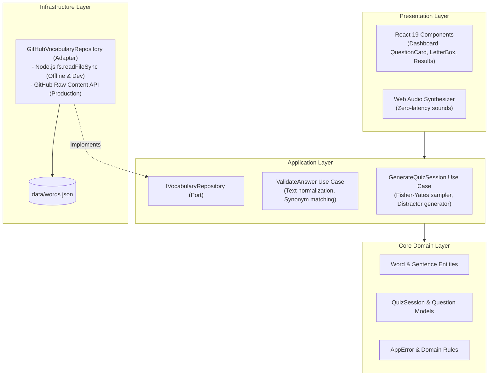

# 02. Technical Architecture

## 1. Clean Architecture Overview

**English Lab** is engineered according to the principles of **Clean Architecture** and **Dependency Inversion**. Business logic, data models, and core algorithms are strictly isolated from UI frameworks, external network APIs, and rendering mechanisms.



---

## 2. Layer Responsibilities

### 1. Core Domain Layer (`src/core/`)
- Contains pure entities: `Word`, `Sentence`, `QuizQuestion`, `QuizSessionConfig`, and `UserAnswerRecord`.
- Houses domain-level normalization functions (e.g., stripping irregular apostrophes and casing).
- Has zero dependencies on Next.js, React, or third-party packages.

### 2. Application Layer (`src/application/`)
- **`IVocabularyRepository` (Port):** An abstract interface declaring required data queries (`getAllWords`, `getWordsByLevel`, etc.).
- **`GenerateQuizSessionUseCase`:** Generates question queues, handles CEFR filtering, and generates 3 randomized distractors for multiple-choice mode.
- **`ValidateAnswerUseCase`:** Validates user submissions against primary definitions, comma-delimited synonyms, and alternate forms.

### 3. Infrastructure Layer (`src/infrastructure/`)
- **`GitHubVocabularyRepository` (Adapter):** Implements `IVocabularyRepository`. Reads directly from local disk (`data/words.json`) in local development and falls back smoothly if GitHub APIs rate-limit.
- **`WebAudioSoundService`:** Directly synthesizes pleasant musical chords and error buzzes using the browser's `AudioContext`.

### 4. Presentation Layer (`src/presentation/`)
- Pure, reusable UI components built with Tailwind CSS.
- **`Header`:** Navigation, logo, sound toggle, and daily streak persistence.
- **`Dashboard`:** Session configuration panel with level chips and mode selectors.
- **`QuestionCard`:** Left split-column displaying prompt, level badges, TTS button, and example sentences.
- **`LetterBoxBoard`:** Right split-column rendering ghost watermarks with keyboard overlay input.
- **`MultipleChoiceBoard`:** 4-option cards with `[1]`, `[2]`, `[3]`, `[4]` hotkeys.
- **`ResultsSummary`:** Accuracy analytics, confetti celebration, and mistake review.

---

## 3. Tailwind CSS CDN Setup

To maintain a fast build footprint and eliminate post-processing overhead, Tailwind CSS is loaded via the official JIT CDN:

In `src/app/layout.tsx`:
```tsx
<head>
  {/* Synchronous script tag guarantees styles are available before initial render */}
  <script src="https://cdn.tailwindcss.com" async={false}></script>
  <script
    dangerouslySetInnerHTML={{
      __html: `
        tailwind.config = {
          darkMode: 'class',
          theme: {
            extend: {
              colors: {
                navy: {
                  950: '#020617',
                  900: '#030a1c',
                  800: '#0a1a3e',
                  700: '#0f275c',
                  400: '#38bdf8',
                }
              }
            }
          }
        };
      `,
    }}
  />
</head>
```

---

## 4. Vercel Deployment Settings

The application is deployed on Vercel with zero extra build steps:
- **Framework Preset:** `Next.js`
- **Build Command:** `npm run build`
- **Output Directory:** `.next`
- **Environment Variables (.env.local):**
  - `GITHUB_WORDS_URL`: *(Optional)* Custom URL to `words.json` raw content.
