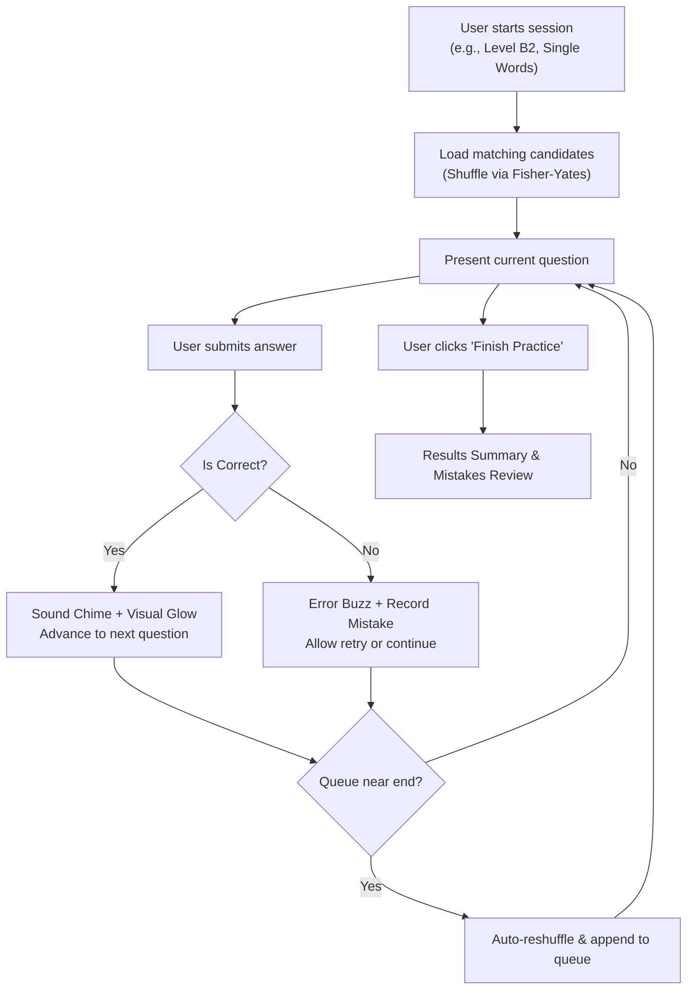

# 04. Game Modes & Core Logic

## 1. Endless Practice Engine

Unlike rigid platforms that force a fixed session length, **English Lab** features an **Endless Practice Queue**:

### Key Principles:
- **No Timers:** Time counting has been intentionally omitted to promote deliberate, low-anxiety memorization.
- **Continuous Stream:** When questions approach the end of the loaded queue, the engine automatically reshuffles the dataset and appends it to the queue without interrupting practice.
- **On-Demand Finish:** Users can click **"Finish (N)"** at any point to view their score, accuracy percentage, and review mistakes.

---

## 2. Mode A: Type Over Ghost Watermark (Letter Box)

This is the flagship active-recall exercise designed to build spelling accuracy and muscle memory.

### Split-Layout Structure:
- **Left Column (Prompt Card):**
  - Displays the prompt word (e.g., Uzbek `"jasur"` in `UZ ➡️ EN` mode).
  - Shows CEFR badge (e.g., `A2`), part-of-speech indicator, and example sentences.
  - Native Text-to-Speech (TTS) speaker button for pronunciation.
- **Right Column (Ghost Letter Slots):**
  - Displays character slots corresponding to the exact length of the target English word (e.g., `B R A V E`).
  - **Ghost Watermark Letters:** Inside each slot, the correct target character is rendered in a faint, semi-transparent style (`opacity: 0.3`).
  - **Overlay Typing:** As the user types, their input is rendered in high-contrast text directly on top of the faint guide:
    - **Correct letter:** Lights up vibrant emerald (`bg-emerald-500/25 border-emerald-400 text-cyan-200`) with a scale-up pop animation.
    - **Incorrect letter:** Shakes with a rose highlight (`bg-rose-500/25 border-rose-400 text-rose-300 animate-shake`).
  - **Pulsing Cursor:** Highlights the slot currently awaiting input.

### Dual Input Mechanisms:
1. **Physical Hardware Keyboard:** Listens directly to standard `keydown` events (A-Z, Backspace, Enter, Escape).
2. **On-Screen Scrambled Keypad:** A touch-friendly palette of scrambled buttons containing all target letters plus random distractors for mobile devices.

---

## 3. Mode B: Multiple Choice (Quiz)

A rapid recognition mode for evaluating passive vocabulary retention.

- **4 Dynamic Options:** One correct answer paired with 3 dynamically selected distractors drawn from other words within the database.
- **Desktop Keyboard Shortcuts:** Numerical hotkeys `[1]`, `[2]`, `[3]`, and `[4]` map to the four choices.
- **Visual Feedback:**
  - Correct option glows emerald with a checkmark badge.
  - Incorrect selection triggers a rose shake while revealing the correct answer.
  - Automatically advances after an 850ms review window.

---

## 4. Practice Directions

| Direction | Left Side (Prompt) | Right Side (Target Answer) | Core Objective |
| :--- | :--- | :--- | :--- |
| **UZ ➡️ EN** | Uzbek term (e.g. `bardoshli`) | English term (e.g. `resilient`) | Active production & spelling |
| **EN ➡️ UZ** | English term (e.g. `resilient`) | Uzbek definition (e.g. `bardoshli`) | Reading comprehension & recognition |

---

## 5. Results & Mistakes Review

Upon concluding a session, the **Results Summary** screen provides:
- **Overall Accuracy:** Visual score badge (e.g., `92% Outstanding!`).
- **Performance Metrics:** Total questions answered, correct count, and incorrect count.
- **Mistakes Review Accordion:** Displays every missed term with the user's submitted answer alongside the verified correct spelling.
- **"Retry Mistakes" Flow:** Launches a targeted practice session containing only the missed terms to ensure total retention.
