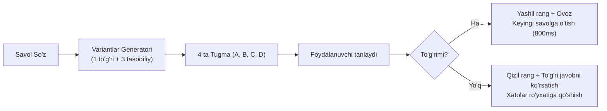

# 04. O'yin Rejimlari va Ishlash Logikasi (Game Modes & Logic)

## 1. Sessiya Yaratish Logikasi (20-Word Session Sampler)

Har bir mashg'ulot umumiy lug'at bazasidan tasodifiy tanlab olingan **20 ta takrorlanmas so'zdan** iborat bo'ladi.

### Algoritm (Fisher-Yates Shuffle):
1. Bazadagi barcha so'zlar massivi olinadi.
2. Agar umumiy so'zlar soni 20 tadan kam bo'lsa, bor so'zlarning barchasi ishlatiladi.
3. Fisher-Yates algoritmi orqali massiv aralashtiriladi va dastlabki 20 ta so'z ajratiladi:

```typescript
export function getRandomSessionWords(allWords: WordItem[], count: number = 20): WordItem[] {
  const shuffled = [...allWords];
  for (let i = shuffled.length - 1; i > 0; i--) {
    const j = Math.floor(Math.random() * (i + 1));
    [shuffled[i], shuffled[j]] = [shuffled[j], shuffled[i]];
  }
  return shuffled.slice(0, count);
}
```

---

## 2. O'rganish Yo'nalishlari (Translation Directions)

Foydalanuvchi mashg'ulotni boshlashdan oldin yo'nalishni tanlaydi:

| Yo'nalish | Savol (Chap tomonda) | Javob (O'ng tomonda) | Maqsad |
| :--- | :--- | :--- | :--- |
| **UZ ➡️ EN** | O'zbekcha tarjimasi (masalan: `bardoshli, chidamli`) | Inglizcha so'z (masalan: `resilient`) | O'zbekcha fikrlab, inglizcha so'zni eslash va to'g'ri yozish |
| **EN ➡️ UZ** | Inglizcha so'z (masalan: `resilient`) | O'zbekcha ma'nosi (masalan: `bardoshli, chidamli`) | Inglizcha so'zni ko'rganda uning ma'nosini tezkor tushunish |

---

## 3. Rejim A: Test (Ko'p Tanlovli Quiz) Logikasi

Bu rejimda foydalanuvchiga 4 ta variant beriladi: **1 ta to'g'ri javob** va bazadagi boshqa so'zlardan olingan **3 ta tasodifiy chalg'ituvchi variant (distractors)**.



### Chalg'ituvchi variantlarni hosil qilish:
- Joriy so'zdan boshqa barcha so'zlar ro'yxati olinadi.
- Ular orasidan tasodifiy 3 tasi tanlanadi.
- To'g'ri javob bilan 3 ta chalg'ituvchi javob yana bir bor aralashtirilib (shuffle), tugmalarga chiqariladi.

---

## 4. Rejim B: Harf To'ldirish (Letter Box / Interactive Spelling) Logikasi

Bu rejim imloni (spelling) mustahkamlash uchun eng samarali usul hisoblanadi.

### Ekran Strukturasi:
- **Chap taraf:** Savol so'z (masalan: o'zbekcha `ko'p qirrali, universal`) + ixtiyoriy misol gap yoki daraja (B2).
- **O'ng taraf:** Yopiq / disabled harf katakchalari (Letter Slots).
  - Harflar soni javob so'zining uzunligiga teng bo'ladi (masalan, `versatile` uchun 9 ta katakcha: `[ ][ ][ ][ ][ ][ ][ ][ ][ ]`).
  - Agar so'zda probel yoki defis bo'lsa, ular oldindan ochiq holda ko'rsatiladi.

```
+------------------------------------+---------------------------------------+
|  CHAP TARAF (Savol)                |  O'NG TARAF (Harf Katakchalari)       |
|                                    |                                       |
|  O'zbekcha:                        |  [ V ] [ E ] [ R ] [   ] [   ] [   ]  |
|  "ko'p qirrali, universal"         |  [   ] [   ] [   ]                    |
|                                    |                                       |
|  Darajasi: C1                      |  Foydalanuvchi harflarni kiritadi...  |
|  Misol: "Python is a ... lang"     |  (Klaviatura yoki Harf tugmalari)    |
+------------------------------------+---------------------------------------+
```

### Kiritish Mexanizmi (Input Handling):
1. **To'g'ridan-to'g'ri klaviatura:** Foydalanuvchi klaviaturada harf bosganda (`event.key`), navbatdagi bo'sh katakchaga harf yoziladi.
2. **Backspace:** Oxirgi to'ldirilgan katakchani tozalaydi va kursor oldingi katakchaga qaytadi.
3. **Ekrandagi harflar banki (Scrambled Letters Palette):**
   - Mobil foydalanuvchilar yoki qiyinchilik tug'ilganda foydalanish uchun ekranning pastida aralashtirilgan to'g'ri harflar (va 2-3 ta qo'shimcha tasodifiy harf) tugmalar ko'rinishida turadi. Tugmani bosganda harf bo'sh katakka o'tadi.
4. **Tekshirish va Feedback:**
   - Oxirgi harf kiritilishi bilan avtomatik tekshiruv ishga tushadi:
     - **To'g'ri bo'lsa:** Katakchalar yashil bo'ladi, muvaffaqiyat animatsiyasi (bounce/pulse) va 700ms dan keyin keyingi savolga o'tadi.
     - **Noto'g'ri bo'lsa:** Katakchalar qizil rangda tebranadi (shake animation), xato harflar tozalanishi yoki foydalanuvchiga qayta urinish imkoni beriladi.
5. **Hint (Yordam) funksiyasi:**
   - Foydalanuvchi so'zni eslay olmasa, "💡 Yordam" tugmasini bosishi mumkin. Tizim navbatdagi bitta to'g'ri harfni katakchada ochib beradi.

---

## 5. Sessiya Yakuni va Statistika (Results & Review)

20 ta so'z tugagach, yakuniy natijalar ekrani ochiladi:
- **Ball va Foiz:** Masalan: `18 / 20 (90% aniqlik)`.
- **Sarf etilgan vaqt:** Masalan: `02:45 daqiqa`.
- **Xato qilingan so'zlar ro'yxati (Mistakes Review):**
  - Foydalanuvchi xato qilgan so'zlar jadvali (so'z, tarjimasi, to'g'ri talaffuzi).
  - **"Xatolarni qayta ishlash" (Retry Mistakes)** tugmasi — faqat xato qilingan so'zlardan iborat mini-sessiya boshlaydi.
- **Kunlik Streak (Ketma-ket kunlar):** LocalStorage orqali foydalanuvchining necha kun ketma-ket dars qilgani qayd etib boriladi.
