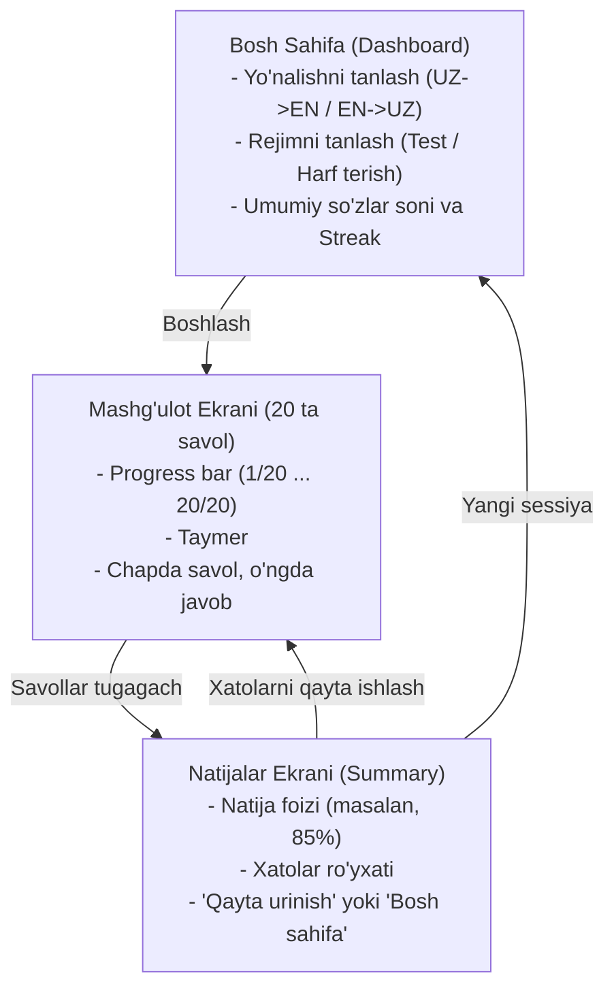

# 05. UI/UX Dizayn va Foydalanuvchi Oqimi (User Interface & Flow)

## 1. Sahifalar va Ekranlar Oqimi (Screen Flow)

---

## 2. Ekranlar Detallari

### 1. Bosh Sahifa (Dashboard):
- **Hero qism:** Zamonaviy sarlavha: *"English Lab — Shaxsiy So'z Boyligingiz Laboratoriyasi"*.
- **Lug'at holati vidjeti:** GitHub'dan yuklangan so'zlarning umumiy soni (masalan: `142 ta so'z mavjud`).
- **Sozlamalar paneli:**
  1. *Yo'nalish:* `O'zbekcha ➡️ Inglizcha` yoki `Inglizcha ➡️ O'zbekcha` (Toggle switch).
  2. *Rejim:* `Quiz Test (4 ta variant)` yoki `Harf to'ldirish (Letter Box)`.
- **Harakatga chaqiruvchi tugma (CTA):** Katta yaltirab turuvchi *"Mashg'ulotni Boshlash (20 ta so'z)"* tugmasi.
- **GitHub havolasi:** To'g'ridan-to'g'ri `data/words.json` faylini ochib, yangi so'z qo'shish uchun havolali tugma.

---

### 2. Mashg'ulot Ekrani (Active Quiz / Letter Workspace):
- **Yuqori panel (Header):**
  - Orqaga chiqish tugmasi (`✕ Chiqish`).
  - Progress bar: 20 ta segmentdan iborat chiziq (har bir to'g'ri javobda yashil, xatoda qizil yonadi).
  - Raqamli ko'rsatkich: `14 / 20`.
  - Qulay taymer: `01:24`.

- **Asosiy qism (2 ustunli Split Layout):**
  - **Chap ustun (Savol kartasi):**
    - Katta va aniq shriftda so'z.
    - Kategoriya va daraja nishoni (Badge: masalan, `General • B2`).
    - Agar mavjud bo'lsa, misol gap (tarjimasi yashirin holda, bosinganda ochiladi).
  - **O'ng ustun (Interaktiv javob qismi):**
    - *Test rejimida:* 4 ta katta zamonaviy karta-tugma (Hover effektlari, klaviaturadagi `1, 2, 3, 4` raqamlariga bog'langan).
    - *Harf to'ldirish rejimida:* Gorizontal qator qilib terilgan disable katakchalar. Har bir to'g'ri harf tushganda yashil rang va sakrash animatsiyasi (scale-up). Pastda mobil klaviatura/harflar palitrasi va `💡 Yordam (Hint)` tugmasi.

---

### 3. Natijalar Ekrani (Results Screen):
- **Tabrik kartasi:** Animatsiyali doiraviy progress (masalan, `95% A'lo!` yoki `70% Yaxshi!`).
- **Statistika kartalari:**
  - Jami vaqt: `02:18`.
  - To'g'ri: `19 ta`.
  - Noto'g'ri: `1 ta`.
- **Xatolar tahlili (Mistakes Accordion):** Xato qilingan so'zlarning to'liq tarjimasi va misollari.
- **Boshqaruv tugmalari:**
  - 🔄 *Xatolar ustida ishlash* (faqat xato qilingan so'zlarni qayta test qilish).
  - 🚀 *Yangi 20 talik boshlash*.
  - 🏠 *Bosh menyuga qaytish*.

---

## 3. Dizayn Qoidalari va Vizual Estetika

- **Ranglar palitrasi (Tailored Theme):**
  - Fon: To'q qora / Ko'k tusli quyuq fon (`#0B0F19` yoki `#0f172a`).
  - Kartalar: Yarim shaffof glassmorphism (`rgba(255, 255, 255, 0.05)`, blur: `16px`, nozik chegara `rgba(255, 255, 255, 0.1)`).
  - Asosiy rang (Primary): Indigo / Violet gradient (`linear-gradient(135deg, #6366f1, #8b5cf6)`).
  - To'g'ri javob (Success): Emerald yashil (`#10b981`).
  - Noto'g'ri javob (Error): Qizil rose (`#f43f5e`).
- **Tipografiya:** Zamonaviy sans-serif shriflar (masalan: `Outfit`, `Inter` yoki `Plus Jakarta Sans`).
- **Klaviatura yorliqlari (Hotkeys):**
  - Test rejimida: `1`, `2`, `3`, `4` variantlarni tanlash.
  - Harf to'ldirishda: Harflar to'g'ridan-to'g'ri klaviaturadan kiritiladi, `Backspace` harfni o'chiradi.
  - Keyingi savolga o'tish: `Enter` yoki `Space`.
