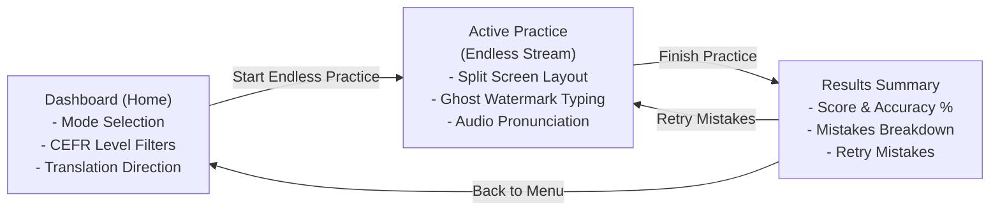

# 05. UI/UX Design & User Flow

## 1. Screen Flow & Navigation

---

## 2. Design System & Aesthetics

### Dark Blue Glassmorphism Theme
The visual identity is built around deep, atmospheric blue tones with translucent frosted-glass surfaces:

- **Deep Space Navy Base:** `#020617` and `#030a1c` background with subtle radial blue/cyan illumination.
- **Frosted Glass Cards (`.glass-card`):**
  - Background: `rgba(10, 22, 47, 0.65)`
  - Blur: `20px` (`backdrop-filter: blur(20px)`)
  - Border: Subtle ice-blue translucent rim (`rgba(147, 197, 253, 0.14)`)
  - Shadow: Deep ambient drop shadow with inset highlight.
- **Accent Palette:**
  - Primary Cyan/Sky: `#38bdf8` and `#0284c7`
  - Success Emerald: `#34d399` and `#10b981`
  - Warning/Mistake Rose: `#f43f5e` and `#fb7185`
  - Hint Amber: `#f59e0b` and `#fbbf24`

### Typography
- Primary UI: **Plus Jakarta Sans** (Google Fonts) for clean readability at all sizes.
- Monospace Data & Badges: **JetBrains Mono** for numerical scores, counters, and hotkey labels.

---

## 3. Responsive Screen Layouts

### 1. Desktop Experience (Width >= 1024px)
- **2-Column Split Layout:** Left and right columns share equal height (`items-stretch`).
  - **Left Card:** Word prompt, CEFR badge, part-of-speech tag, example sentences, and audio pronunciation.
  - **Right Card:** Ghost-letter typing board with spacious boxes and on-screen helper buttons.
- **Top Bar:** Pinned session tracker with question counter and finish button.

### 2. Mobile Experience (Width < 768px)
- **Fluid Vertically Stacked Layout:**
  - Compact header to preserve vertical screen real estate.
  - Left card adapts into a clean top question banner.
  - Right card letter slots wrap automatically to accommodate long words without horizontal scrolling.
  - Touch-optimized scrambled keypad with 44px+ minimum tap targets for effortless one-handed thumb typing.

---

## 4. Keyboard Shortcuts & Accessibility

| Context | Action | Key |
| :--- | :--- | :--- |
| **Letter Typing** | Type letter | `A` – `Z` (Hardware keys) |
| **Letter Typing** | Delete previous letter | `Backspace` |
| **Letter Typing** | Clear all entered letters | `Escape` |
| **Multiple Choice** | Select option 1, 2, 3, or 4 | `[1]`, `[2]`, `[3]`, `[4]` |
| **Header** | Toggle sound on/off | Audio button click |
