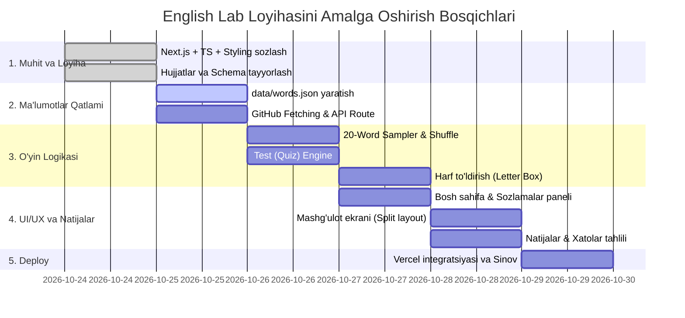

# 06. Bosqichma-bosqich Reja (Roadmap & Implementation)

## 1. Ishlab Chiqish Bosqichlari (Phase by Phase)



---

## 2. Har Bir Bosqichning Aniq Vazifalari

### 1-Bosqich: Loyihani Yaratish va Konfiguratsiya
- [x] `documents/` papkasida to'liq texnik spetsifikatsiyalarni yozish.
- [ ] Next.js (App Router, TypeScript) loyihasini o'rnatish:
  ```bash
  npx create-next-app@latest ./ --typescript --tailwind --eslint --app --src-dir --import-alias "@/*"
  ```
- [ ] Kerakli kutubxonalarni o'rnatish (`lucide-react` chiroyli ikonalar uchun, `canvas-confetti` g'oliblik animatsiyasi uchun).

### 2-Bosqich: Ma'lumotlar Qatlami (Data Layer)
- [ ] `data/words.json` faylini kamida 30-40 ta so'z bilan shakllantirish.
- [ ] `src/types/word.ts` orqali TypeScript interfeyslarini belgilash.
- [ ] `src/lib/github.ts` da GitHub repo yoki lokal fayldan so'zlarni o'quvchi xizmatni yozish (`next: { revalidate: 60 }`).
- [ ] `/api/words` endpointini yaratish.

### 3-Bosqich: O'yin Dvigateli (Core Engines)
- [ ] `src/lib/quiz-sampler.ts`:
  - 20 ta so'zni tasodifiy tanlab beruvchi funksiya.
  - Test rejimida 3 ta tasodifiy chalg'ituvchi variant (distractor) generatori.
- [ ] `src/hooks/useLetterBox.ts`:
  - Harf katakchalarini boshqarish, navbatdagi bo'sh katakchani aniqlash.
  - Klaviatura hodisalarini (`keydown`) tinglash va harflarni tekshirish.

### 4-Bosqich: UI Komponentlarini Yig'ish
- [ ] **Boshqaruv paneli (Dashboard):** Rejim va yo'nalish tanlash, boshlash tugmasi.
- [ ] **Sessiya ekrani:**
  - Progress bar va vaqt hisoblagich.
  - Chap taraf: So'z kartasi (UZ yoki EN).
  - O'ng taraf: Test variantlari yoki Harf to'ldirish katakchalari.
- [ ] **Natijalar sahifasi:** To'g'ri/xato hisobi, sarflangan vaqt, xato so'zlarni takrorlash tugmasi.

### 5-Bosqich: Vercel-ga Yuklash va Sinov
- [ ] GitHub-ga loyihani yuklash (`git push origin main`).
- [ ] Vercel bilan GitHub repozitoriysini ulash.
- [ ] Vercel Environment Variables sozlash (kerak bo'lsa `GITHUB_TOKEN`).
- [ ] Loyihani jonli rejimda (Production) tekshirish va yangi so'z qo'shilganda yangilanishini sinash.
