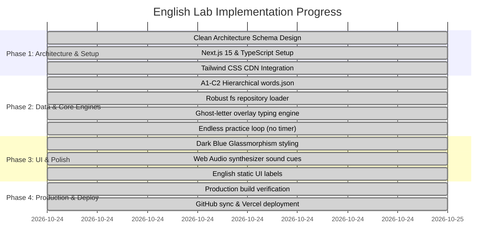

# 06. Implementation Roadmap

## 1. Project Milestones & Progress

---

## 2. Checklist of Completed Implementations

### Phase 1: Environment & Architecture
- [x] Initialized Next.js 15 App Router with TypeScript.
- [x] Configured native synchronous Tailwind CSS CDN in `src/app/layout.tsx`.
- [x] Implemented Clean Architecture directory hierarchy (`core/`, `application/`, `infrastructure/`, `presentation/`, `app/`).

### Phase 2: Data Layer & Core Logic
- [x] Structured `data/words.json` with CEFR levels (`A1`–`C2`), single words, and contextual sentence arrays.
- [x] Created `GitHubVocabularyRepository` utilizing Node.js file system reading to eliminate Webpack runtime chunk errors.
- [x] Implemented `GenerateQuizSessionUseCase` with Fisher-Yates randomization.
- [x] Built `ValidateAnswerUseCase` supporting text normalization and synonym resolution.

### Phase 3: User Interface & Audio
- [x] Built `Header` featuring local streak tracking, audio mute/unmute, and GitHub navigation.
- [x] Engineered `Dashboard` with CEFR chips, exercise mode toggle, and live vocabulary counters.
- [x] Implemented `LetterBoxBoard` featuring ghost watermark overlay typing, active cursor glow, and on-screen keypad.
- [x] Implemented `MultipleChoiceBoard` with `[1]`–`[4]` keyboard hotkeys.
- [x] Implemented procedural audio synthesizer via `WebAudioSoundService`.
- [x] Converted all static UI copy and error prompts to English.

### Phase 4: Verification & Deployment
- [x] Validated production bundle with `npm run build` (0 errors, optimal static generation).
- [x] Tested dev server on `http://localhost:3000` with live API endpoints.
- [x] Pushed all clean commits to GitHub (`main` branch).
- [x] Ready for 1-click automated deployment on Vercel.
